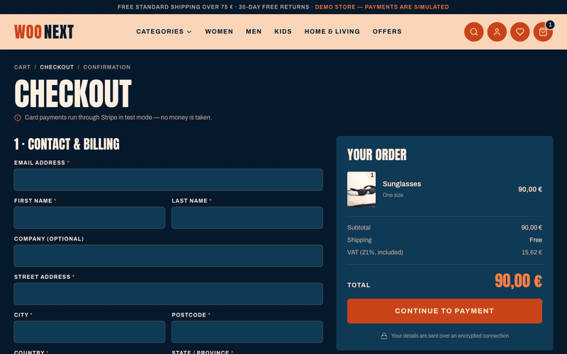
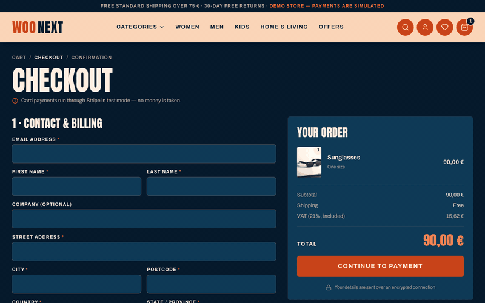

# [WooCommerce Nextjs React Theme](https://codeytek.org/course/react-woocommerce-theme-with-nextjs-course/) :rocket:
[](https://www.repostatus.org/#active)


> * A headless WooCommerce storefront built with Next.js, React, Tailwind CSS and GraphQL —
> with a full catalog, variable-product support, cart, coupons and Stripe checkout.

📹 [Full Course Video Tutorial](https://codeytek.org/course/nextjs-woocommerce-graphql-course/)

## Important Note ⭐:
The code for the Video Tutorial is in the branch [youtube-course](https://github.com/imranhsayed/woo-next/tree/youtube-course)
However, since there is continuous contribution and updates to this project. The 'master'
branch is upto date with those changes. You can also refer to the PR notes for changes.

## Demo Desktop :video_camera:


## Single Product Page Demo :tshirt:

Variation picking on a real WooCommerce product — per-size pricing, sold-out
size/colour combinations, add to bag, and the product information tabs.


## Live Demo:

[[Live Demo Site]](https://woo-next-delta.vercel.app/)

## Checkout Page Demo


## Stripe Checkout 
[Stripe Demo Video](https://youtu.be/i75_Vtx-CnA)


# Features

### Storefront

* **Home** — hero, category tiles, featured products, editorial sections, testimonials and an FAQ accordion
* **Catalog** — `/shop`, category and subcategory landing pages, and search
* **Filtering** — by category, size, colour, price band and availability, with live result counts
* **Sorting** — relevance, newest, popularity, price ascending and descending
* **Product page** — gallery with zoom and a full-screen viewer, variation picker, size guide, reviews, related products and recently viewed
* **Variable products** — per-variation pricing and stock, with unavailable size/colour pairings disabled
* **Cart** — slide-over drawer plus a full cart page, quantity editing, coupons and a free-shipping meter
* **Checkout** — contact and billing, optional separate delivery address, shipping and payment selection, order notes
* **Order confirmation** — reads the real order, with a key-gated server-side lookup so guests can view their own order
* **Wishlist** and **quick view**

### Technical

* Next.js 16 with Turbopack, React 19
* Incremental Static Regeneration — catalog and product pages are prerendered and revalidated
* GraphQL via Apollo Client, against WPGraphQL and WooGraphQL
* Tailwind CSS 3 with a custom design token set
* Stripe Checkout (session + webhook) alongside WooCommerce's own gateways
* Accessible by construction — focus traps on every dialog, roving-tabindex tabs, visible focus rings, `prefers-reduced-motion` honoured throughout
* SEO friendly, automatic code splitting, prefetching

## Getting Started :rocket:

These instructions will get you a copy of the project up and running on your local machine for development purposes.

### Prerequisites :page_facing_up:

* Node.js `20.9.0` or later ( required by Next.js 16 )

### Installing :wrench:

1. Clone this repo using terminal `git clone git@github.com:imranhsayed/woo-next`
2. `cd woo-next`
3. `npm install`
4. Copy `.env-example` to `.env.local` and fill in your values
5. `npm run dev`

## Add GraphQl support for WordPress

1. Download and activate the following plugins , in your WordPress plugin directory:

* [wp-graphql](https://github.com/imranhsayed/woo-next/tree/master/wordpress/plugins) Exposes GraphQL for WordPress ( **tested with v2.26.2** )
* [wp-graphql-woocommerce](https://github.com/imranhsayed/woo-next/tree/master/wordpress/plugins) Adds WooCommerce to the WPGraphQL schema ( **tested with v1.0.3** ) — install the **built release zip**, not the GitHub source archive, which omits `vendor/` and fatals on every request
* [headless-cms](https://github.com/imranhsayed/woo-next/tree/master/wordpress/plugins) Extends the schema with the `wooCountries` and `wooStates` fields checkout needs ( **tested with v2.0.4** )

* Make sure Woocommerce plugin is also installed in your WordPress site. You can also import default wooCommerce products that come with wooCommerce Plugin for development ( if you don't have any products in your WordPress install ) `WP Dashboard > Tools > Import > WooCommerce products(CSV)`: The WooCommerce default products csv file is available at `wp-content/plugins/woocommerce/sample-data/sample_products.csv`

## WooCommerce store setup

The storefront reads everything from WooCommerce, so a few store settings decide
what it can show.

**Products** — categories drive the navigation. Top-level categories become the
main nav and the mega menu; their children become the subcategory filters. Use
parent-prefixed child slugs (`women-tops`, `kids-outerwear`) since term slugs are
global and names like "Outerwear" repeat across departments.

**Shipping** — create a zone covering the countries you sell to and add the
methods you want. Their titles and costs are shown as-is at cart and checkout.

**Coupons** — any WooCommerce coupon works; the cart and checkout both accept codes.

**Tax** — if your catalog prices include tax, set *prices entered with tax* and
WooCommerce's tax display to **including tax**. The storefront adds each net
figure to its tax when showing a total, so this must match or totals will read low.

**Payments** — whichever gateways you enable are offered at checkout, filtered
against the `paymentGateways` query. Card is handled separately through Stripe.

## Configuration :wrench:

* _Note_ Below is for the GraphQL implementation. For REST API see the [feature/rest-api](https://github.com/imranhsayed/woo-next/tree/feature/rest-api) branch.

Copy `.env-example` to `.env.local` and fill in:

| Variable | Required | Purpose |
|---|---|---|
| `NEXT_PUBLIC_WORDPRESS_URL` | yes | Your WordPress site, without a trailing slash |
| `WC_CONSUMER_KEY` / `WC_CONSUMER_SECRET` | for card payments | WooCommerce REST keys, used server-side to create the order before Stripe and to read it back on the confirmation page |
| `STRIPE_SECRET_KEY` | for card payments | Stripe secret key |
| `STRIPE_WEBHOOK_ENDPOINT_SECRET` | for card payments | Verifies the webhook that marks a paid order `processing` |

### Stripe webhook

A card order is created as `pending` and only becomes `processing` once Stripe
calls the webhook. Stripe cannot reach `localhost`, so forward it while developing:

```bash
stripe listen --forward-to localhost:3000/api/stripe-web-hook
```

## Branch details

1. [feature/rest-api](https://github.com/imranhsayed/woo-next/tree/feature/rest-api) Contains REST API Implementation.

2. The `master` branch has the GraphQL implementation.

## Common Commands :computer:

* `npm run dev` Start the development server
* `npm run build` Build for production
* `npm start` Serve the production build
* `npm run svg` Regenerate icon components from `src/components/icons/svgs`

## Code Contributors ✰

Thanks to all the people who contributed to the code of this project 🤝

<div>
    
    
    
    
</div>


## Contributing :busts_in_silhouette:

Please read [CONTRIBUTING.md](https://gist.github.com/PurpleBooth/b24679402957c63ec426) for details on our code of conduct, and the process for submitting pull requests to us.

## Versioning :bookmark_tabs:

I use [Git](https://github.com/) for versioning.

## Author :bust_in_silhouette:

* **[Imran Sayed](https://twitter.com/imranhsayed)**

## License :page_with_curl:

This project is licensed under the MIT License - see the [LICENSE.md](LICENSE.md) file for details
